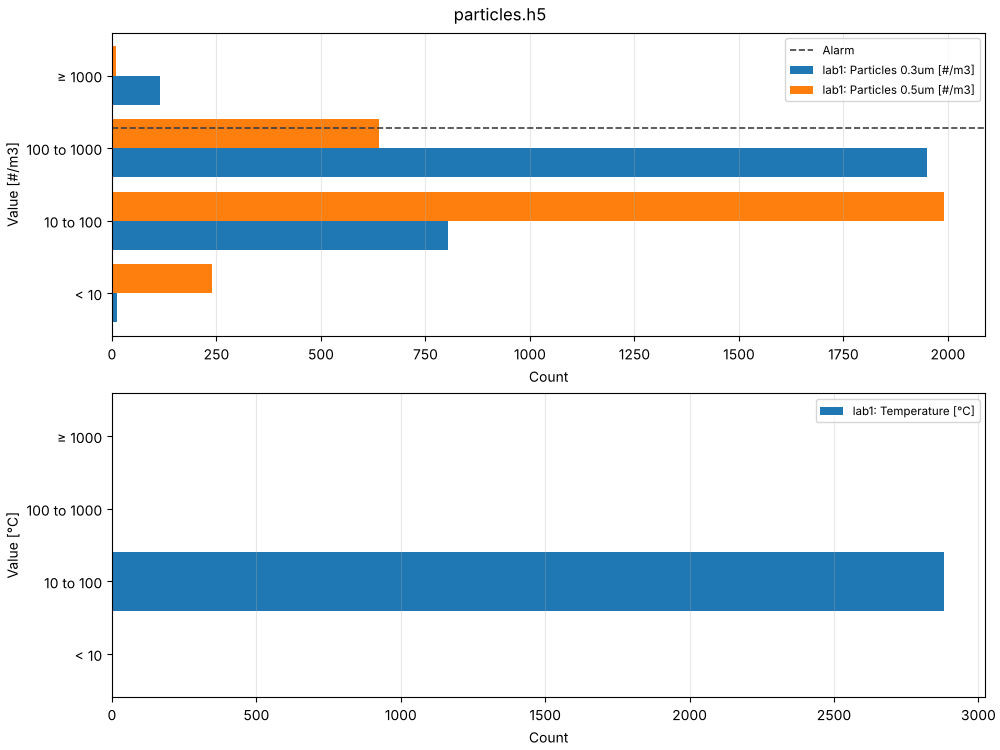
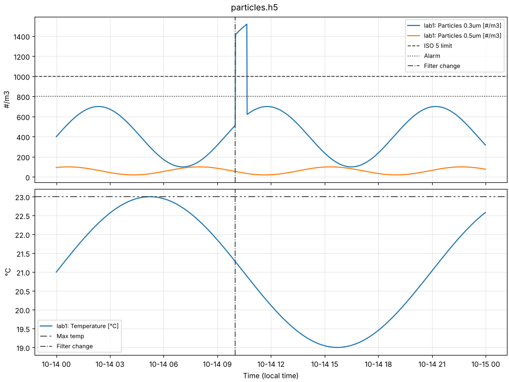

Analysing the data
==================

What's in a file
----------------

``zabgrab info`` lists the items a ``.mat`` or ``.h5`` file holds, merged across its
fetch groups: each item's ID, host, name, key and units, whether it's raw data or
hourly trends, and how many points it has over what time range.

.. code-block:: bash

   zabgrab info particles.h5
   zabgrab info particles.h5 --groups       # the fetch groups instead
   zabgrab info particles.h5 --overlaps     # ... and the points they share

``--overlaps`` lists the groups with a *Repeated* column: how many of each group's
points another group also holds (the same item at the same time), as happens when
``fetch --append`` adds a range already in the file. ``plot``, ``export`` and
``zabgrab_load`` merge the groups, keeping each point once, so repeated points do no
harm, but they take up space; ``zabgrab export`` writes a copy of the file that
holds each point once.

.. _choosing-items:

Choosing items, times and groups
--------------------------------

``zabgrab info``, ``plot``, ``export`` and ``show`` choose what to use from a file
the same way, so ``info`` shows what the others would use:

``--item SPEC`` (``-i``)
   Items selected by an :ref:`item spec <item-specs>`, just as when fetching: an
   item ID (``12345``), a name pattern (``*0.3um``), or fields such as
   ``host=lab1,name=*0.3*,tag=area:lab``. It selects exactly what the same spec
   selects in ``zabgrab items`` and ``fetch``: patterns match the whole value,
   ignoring case, with ``*`` matching any text, and a tag must be one the item had
   when it was fetched. Repeat for several.
``--match PATTERN`` (``-m``)
   Items whose whole ID, name, key or ``host: name`` matches a pattern, ignoring
   case, with Python's `fnmatch <https://docs.python.org/3/library/fnmatch.html>`_
   wildcards: ``*`` matches any text, ``?`` any one character, ``[seq]`` any
   character in *seq* (e.g. ``[0-9]``), and ``[!seq]`` any character not in it.
   For example, ``--match "lab1: *0.3um"`` or ``--match "*[05].?um"``. Repeat for
   several.
``--from TIME``, ``--to TIME``
   A time range.
``--group NAME``
   Only some fetch groups (repeat for several).

Items are used if any ``--item`` or ``--match`` selects them, or if neither is
given.

.. code-block:: bash

   zabgrab info particles.h5 --item "host=lab1,name=*0.3*"
   zabgrab plot particles.h5 --item "*0.3um" --from "2 days ago"
   zabgrab export particles.h5 -o recent.csv --match "*0.5um" --from "1 week ago"

If nothing matches, ``plot``, ``export`` and ``show`` say so, and suggest ``zabgrab
info`` to see what the file holds.

Plotting
--------

With the ``plot`` extra installed (``pip install 'zabgrab[plot]'``), ``zabgrab plot``
shows a file's data in a window, or saves the figure:

.. code-block:: bash

   zabgrab plot particles.h5
   zabgrab plot particles.h5 -o particles.png        # or .pdf, .svg, ...
   zabgrab plot particles.h5 -o plot.png -o plot.pdf # several formats
   zabgrab plot particles.h5 --item "*0.3um" --from "2 days ago"
   zabgrab plot particles.h5 --log                   # log scales

All of a file's groups are plotted as one dataset. Items with the same units share an
axis, and times are shown in your local time (or the ``timezone`` setting). Hourly
trends are drawn as the average, with the minimum and maximum as a shaded band. Lines
only break where no fetch covered the time, so sparse data and appended groups join
up, and gaps show where data is missing. Text items can't be plotted.

Choose what to plot with ``--item``, ``--match``, ``--from``, ``--to`` and
``--group`` (see :ref:`choosing-items`).

``zabgrab fetch --plot`` plots data as it's fetched (see :doc:`fetching`). Text
items can't be plotted, but ``zabgrab show`` lists them (see :doc:`showing`).

.. _histograms:

Histograms
~~~~~~~~~~

``--bin`` draws a histogram instead: how many of each item's values fall in each
bin, for edges you choose (in increasing order):

.. code-block:: bash

   zabgrab plot particles.h5 --bin 10,100,1000
   zabgrab plot particles.h5 --bin 10,100,1000 --log        # log scale counts
   zabgrab plot particles.h5 --bin 10,100,1000 -o bins.png

         fall in the bins below 10, 10 to 100, 100 to 1000 and 1000 and above,
         with a horizontal line at a count of 1000 and a vertical alarm line at a
         value of 800.

N edges make N + 1 bins, the first and last open-ended, and each bin includes its
lower edge but not its upper one, as numpy's do (see :ref:`bins` for the details).

The bins go along the bottom, lowest on the left, with the counts up the side;
``--log`` puts the counts on a log scale. The bins are drawn the same width and
labelled with their ranges, since the open bins have no width and the others can
differ by orders of magnitude. Each item's bars sit side by side in each bin, items
with different units get a plot each, hourly trends' averages are counted, and text
items are left out. ``--hline`` and ``--vline`` mark counts and values on them (see
:ref:`reference-lines`).

.. _reference-lines:

Reference lines
~~~~~~~~~~~~~~~

``--hline`` and ``--vline`` draw horizontal and vertical lines, such as limits,
alarm levels or events, each with a label in the legend. Each marks a position on
its axis, in that axis's terms:

=============== ============================ =====================================
Plot            ``--hline`` (horizontal)     ``--vline`` (vertical)
=============== ============================ =====================================
Over time       a value, e.g. a limit        a time, e.g. a maintenance visit
Histogram       a count, e.g. most allowed   a value among the bins, e.g. a limit
=============== ============================ =====================================

Repeat either option for as many lines as you like:

.. code-block:: bash

   zabgrab plot particles.h5 --hline 1000
   zabgrab plot particles.h5 --hline "ISO 5 limit=1000" --hline "Alarm=800"
   zabgrab plot particles.h5 --hline "Alarm=800 #/m3" --hline "Max temp=23 °C"
   zabgrab plot particles.h5 --vline "Filter change=2026-10-14 10:00"
   zabgrab plot particles.h5 --bin 10,100,1000 --hline "Most allowed=1000" \
       --vline "Alarm=800 #/m3"

Quote each line that has spaces, so the shell keeps it together.

Lines at a number
^^^^^^^^^^^^^^^^^

``--hline``, and ``--vline`` with ``--bin``, are written ``[LABEL=]VALUE [UNITS]``:

``LABEL=``
   The name in the legend: everything before the last ``=``, so a label can
   contain ``=`` itself. Without a label, the line is labelled with its value, as
   written (e.g. ``1000``).
``VALUE``
   Where the line goes, e.g. ``800``, ``-2.5`` or ``1e3``: in the data's units, or
   for ``--hline`` on a histogram, a count.
``UNITS``
   After the value and a space: draw the line only on the plot of items with
   exactly these units, as shown in their labels (e.g. ``#/m3`` or ``°C``).
   Without units, the line is drawn on every plot. A line whose units no plotted
   item has isn't drawn, with a warning.

Lines at a time
^^^^^^^^^^^^^^^

``--vline`` on plots over time is written ``[LABEL=]TIME``, with the time in any
form ``--from`` takes (e.g. ``2026-10-14 10:00``, ``14/10/2026`` or ``yesterday``),
in your local time or the ``timezone`` setting. Times can contain spaces, so they
take no units: the line is drawn on every plot. Without a label, the line is
labelled with its time, as written.

         (800), a temperature with a line at its maximum (23), and a vertical
         line at a filter change.

How they're drawn
^^^^^^^^^^^^^^^^^

The lines are dark grey, each with its own dash pattern, the same on every plot,
so they're told apart from the data and from each other. A line beyond the data
stretches the axis to include it, showing how far the data is from it. On a log
scale (``--log``), lines at zero or below can't be drawn, and are left out with a
warning.

On histograms, an ``--hline`` crosses the bars at its count, showing which bins
exceed it, and a ``--vline`` goes among the bins at its value:

- at an edge, exactly between the two bins it separates;
- inside a bin between two edges, in proportion between them: with ``--bin
  10,100,1000``, ``--vline 550`` goes halfway across the ``100 to 1000`` bin;
- inside the first or last bin, which are open-ended and have no width to
  measure against, across the bin's middle, with a warning. Add the value to
  ``--bin`` to put the line on an edge instead.

MATLAB
------

``.mat`` files load with MATLAB's ``load``. Each fetch group is a variable holding a
struct per item, named ``item_<ID>``:

.. code-block:: matlab

   S = load('particles.mat');
   item = S.fetch_0001.items.item_41207;
   item.name, item.units          % the item's details
   item.time                      % N x 1 POSIX times (seconds since 1970, UTC)
   item.value                     % N x 1 values
   t = datetime(item.time, 'ConvertFrom', 'posixtime', 'TimeZone', 'UTC');

For files updated many times, it's easier to load every group at once, merged, with
``zabgrab_load``. Download `zabgrab_load.m
<https://github.com/SeanDS/zabgrab/blob/main/matlab/zabgrab_load.m>`_ and put it on
your MATLAB path; it reads ``.mat`` and ``.h5`` files:

.. code-block:: matlab

   S = zabgrab_load('particles.h5');      % a struct array, one element per item
   plot(S(1).time, S(1).value)            % time is a UTC datetime
   title(sprintf('%s: %s [%s]', S(1).host, S(1).name, S(1).units))

Each element has the item's details (``itemid``, ``host``, ``name``, ``key``,
``units``, ...), ``time``, and its values: ``value`` for raw data, and ``min``,
``avg``, ``max`` and ``count`` for hourly trends. Log items also have ``log_time``,
``source``, ``severity`` and ``event_id``. Text values are cell arrays of char.

``.h5`` files can also be read with MATLAB's ``h5read``:

.. code-block:: matlab

   value = h5read('particles.h5', '/fetch_0001/items/item_41207/value');

Python
------

``.h5`` files are plain HDF5, readable with `h5py <https://www.h5py.org/>`_:

.. code-block:: python

   import json

   import h5py
   import pandas as pd

   with h5py.File("particles.h5") as file:
       for name, group in file.items():               # fetch_0001, fetch_0002, ...
           metadata = json.loads(group["meta"][()])
           for item in group["items"].values():
               label = f"{item['host'].asstr()[()]}: {item['name'].asstr()[()]}"
               times = pd.to_datetime(item["time"][:], unit="s", utc=True)
               values = item["value"][:]

Text values are stored as UTF-8 strings (use ``.asstr()`` to read them as Python
strings).

TSV and CSV files start with the metadata as ``#`` comment lines, then a header row,
then the data: a time column and a value column for each item (or ``min``, ``avg``,
``max`` and ``count`` columns for hourly trends), named after the item, as in
``lab1: Particles 0.3um time`` (see :doc:`files`). Times are ISO 8601, in local time
(or the ``timezone`` setting). Read them with pandas:

.. code-block:: python

   import pandas as pd

   data = pd.read_csv("particles.tsv", sep="\t", comment="#")

Items have different numbers of values, so shorter columns are padded with empty
cells. Log entries can contain newlines, which pandas handles but simpler readers
such as ``numpy.loadtxt`` don't.

File layout
-----------

:doc:`files` describes the files in full: the layout of ``.h5`` and ``.mat`` files,
the columns of TSV and CSV files, and everything the metadata records.

Exporting and converting
------------------------

``zabgrab export`` writes a file's data, merged across its groups, to a new file. Use
it to flatten a file that's been updated many times, to convert between formats, or
to extract some items or a time range:

.. code-block:: bash

   zabgrab export particles.h5 -o particles.mat
   zabgrab export particles.h5 -o recent.csv --item "*0.3um" --from "2 days ago"
   zabgrab export particles.h5 -o flat.h5 -o flat.csv     # several files at once

It chooses items, times and groups as described in :ref:`choosing-items`.
